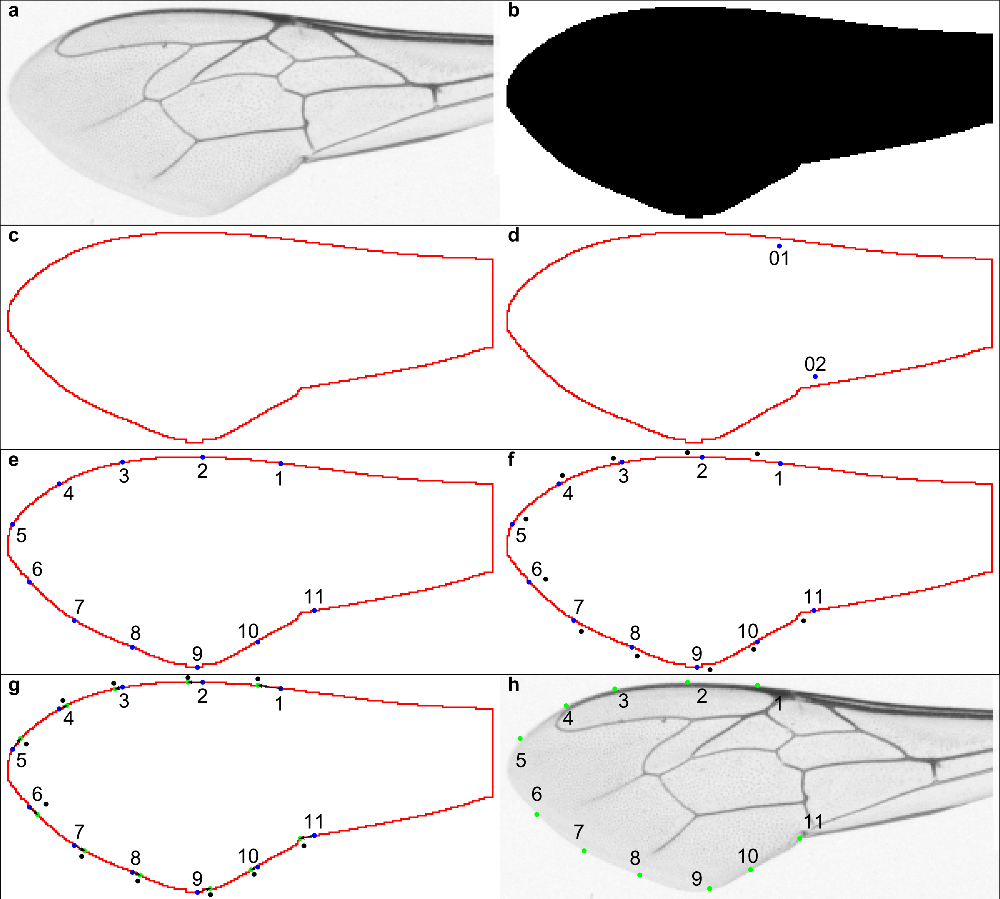
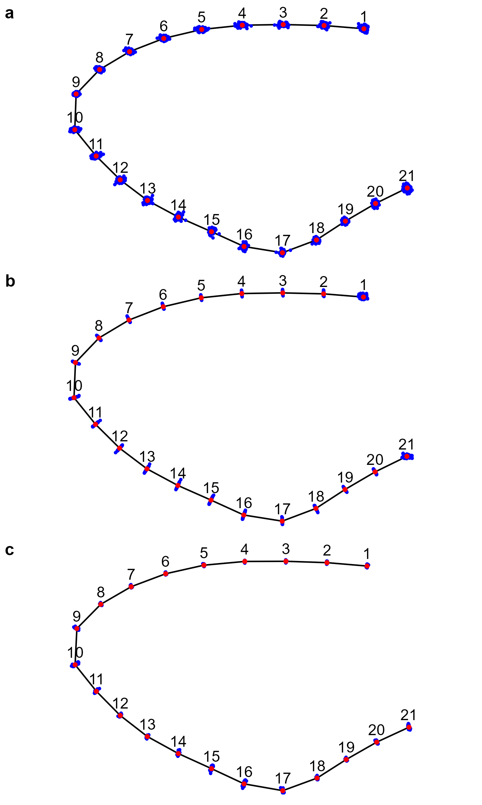

# Semilandmarks along pixel outline

For details see [supplementary document with statistical analysis](https://drawwing.github.io/Semilandmarks-along-outline/SaO.html)

## Figure 1

The process of aligning semilandmarks along the outline. The thresholding algorithm is applied to the original image (a) to obtain a black and white image (b). An outline (red pixels) is created around the largest black object (c). Two initial landmarks 01 and 02 are used to find the start and end pixels of the curve to be measured (d). The outline between the start and end pixels is divided into ten segments by eleven equidistant semilandmarks (blue dots) (e). The reference configuration (black dots) is aligned with the equidistant landmarks (f). Each equidistant semilandmark is moved along the outline to the position closest to the corresponding semilandmark in the reference configuration (g). Semilandmarks after correction along outline (green dots) on original image (h).  
  

## Figure 2

Variation of semilandmarks around forewings of honey bees. The semilandmarks were initially placed at equidistant intervals without corrections (a), corrected by sliding along tangents (b), and corrected by sliding along the wing outline (c). Red dots indicate mean configurations, and blue dots indicate individual semilandmarks.  
  
